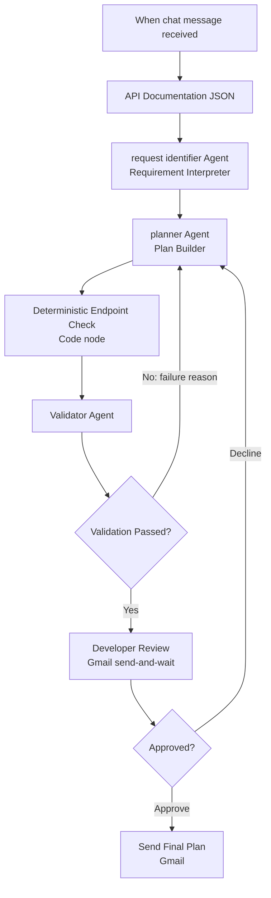

# ConnectX API Integration Planner (n8n)

An n8n workflow that turns a plain-English integration request into a **validated, developer-approved API integration plan** for the fictional *ConnectX Orders API*. It combines three LLM agents, a deterministic (non-AI) endpoint check, and a human approval step, so the final plan only ever references endpoints that really exist in the documentation.

> **Status:** Demo / coursework project. The ConnectX API (`https://api.connectx.demo/v1`) is fictional. No real credentials or live API calls are used.

---

## Table of Contents

- [How It Works](#how-it-works)
- [Workflow Diagram](#workflow-diagram)
- [Node Reference](#node-reference)
- [The Documented API](#the-documented-api)
- [Safety and Review Rules](#safety-and-review-rules)
- [Requirements](#requirements)
- [Setup](#setup)
- [Usage](#usage)
- [Example Requests](#example-requests)
- [Known Limitations](#known-limitations)
- [Repository Structure](#repository-structure)

---

## How It Works

1. **Chat trigger**: a developer describes an integration need in plain English (requesting team, business requirement, data needed, destination, frequency).
2. **Requirement Interpreter Agent** (`request identifier Agent`): extracts structured intent only. It is explicitly forbidden from guessing endpoints or parameters.
3. **Plan Builder Agent** (`planner Agent`): maps the intent to the documented endpoints, using the API documentation JSON as its *only* source of truth. If the need cannot be met, it must return `supported: false` and explain what is missing rather than invent functionality.
4. **Deterministic Endpoint Check**: a Code node compares every endpoint path in the plan against the real documented paths using plain string comparison, with no AI involved.
5. **Validator Agent**: receives the plan plus the deterministic check result. If the check failed, it **must** fail the plan. Otherwise it checks that unsupported claims are accurate, that the endpoint choice fits the requirement, and that no credential is exposed.
6. **Validation gate**: on failure, the plan goes back to the Plan Builder with the failure reason for revision.
7. **Developer Review**: an email with an Approve / Decline form is sent and the workflow waits (up to 45 minutes).
8. **Approved?**: *Approve* sends the final plan by email. *Decline* sends the plan back to the Plan Builder for a revised version.

## Workflow Diagram



## Node Reference

| Node | Type | Purpose |
|---|---|---|
| When chat message received | Chat Trigger | Entry point; receives the plain-English requirement |
| API Documentation (JSON) | Set | Holds the full API docs, rules, and error reference as structured data |
| request identifier Agent | AI Agent | Extracts structured intent (team, requirement, fields, filters, record type, frequency, destination) |
| planner Agent | AI Agent | Builds the integration plan strictly from the documentation; also handles revisions |
| Deterministic Endpoint Check | Code | Flags any endpoint path not present in the documentation |
| Validator Agent | AI Agent | Final grounding and correctness check; outputs `pass` and `failure_reason` |
| Validation Passed? | IF | Routes failed plans back to the planner |
| Developer Review | Gmail (send and wait) | Human approval step with Approve / Decline dropdown |
| Approved? | IF | Routes approved plans to delivery and declined ones back to the planner |
| Send Final Plan | Gmail | Emails the approved plan |
| Chat Model | OpenRouter | `openai/gpt-4o-mini`, shared by all three agents |
| Output Parsers (x3) | Structured Output Parser | Enforce the JSON schema for each agent's output |

## The Documented API

The workflow treats this as the **complete** API surface. Anything else is reported as unsupported.

**Base URL:** `https://api.connectx.demo/v1`  |  **Format:** JSON  |  **Auth:** `X-API-Key` header  |  **Rate limit:** 100 requests/minute

| # | Method | Path | Purpose |
|---|---|---|---|
| 1 | GET | `/orders/{order_id}` | Get a single order |
| 2 | GET | `/orders` | List orders (filters: `start_date`, `end_date`, `status`, `customer_id`, `page`, `limit`) |
| 3 | GET | `/customers/{customer_id}` | Get basic customer details |
| 4 | GET | `/orders/{order_id}/delivery` | Get delivery information for an order |

- **Order statuses:** `pending`, `processing`, `ready_for_shipping`, `shipped`, `completed`, `cancelled`
- **Pagination:** `/orders` returns at most 50 records per request; use `page` and `limit`.
- **Errors covered:** 200, 400, 401, 403, 404, 429, 500, 503, each with handling guidance.

## Safety and Review Rules

The plan builder and validator enforce these rules:

- **Endpoint accuracy:** only documented endpoints may be used; none are invented.
- **Parameter accuracy:** required parameters are always included; optional ones only when relevant.
- **Authentication:** the requirement is noted, and credential values are never exposed.
- **Pagination and rate limits:** considered whenever a request could exceed one page or involve polling.
- **Error handling:** only relevant error codes are included, with guidance.
- **Data minimization:** only the fields needed for the business purpose are retrieved.
- **Unsupported requirements:** limitations are stated clearly instead of being worked around.
- **Human review:** a developer must approve the plan before it is sent for implementation.

## Requirements

- [n8n](https://n8n.io/) (cloud or self-hosted) with the **AI / LangChain nodes** available
- An [OpenRouter](https://openrouter.ai/) API key (model used: `openai/gpt-4o-mini`)
- A Google account with **Gmail OAuth2** credentials configured in n8n

## Setup

1. **Import the workflow:** in n8n, go to *Workflows → Import from File* and select the workflow JSON from this repo.
2. **Reconnect credentials:** imported workflows do not carry your secrets. Create and assign:
   - **OpenRouter account** → `Chat Model` node
   - **Gmail OAuth2** → `Developer Review` and `Send Final Plan` nodes
3. **Set the reviewer email:** update the `sendTo` field in both Gmail nodes to the address of the developer who should approve plans.
4. **(Optional) Change the model:** edit the `Chat Model` node to use any model available on OpenRouter.
5. **Activate** the workflow, or run it from the editor with *Test workflow*.

> Never commit real API keys, OAuth tokens, or credential IDs. Keep secrets in n8n's credential store.

## Usage

Open the chat trigger (the *Chat* button in the editor, or the public chat URL if enabled) and describe your requirement, ideally including:

- the **requesting team**
- the **business requirement**
- the **data fields** needed
- any **filters** (dates, status, customer)
- the **frequency** (one-off, hourly, daily, ...)
- the **destination** (spreadsheet, dashboard, database, ...)

The reviewer then receives an email with the proposed plan and an **Approve / Decline** form. On approval, the final plan is emailed out.

## Example Requests

**Supported**

> The Finance team needs a daily export of all completed orders from the previous day, including order ID, customer ID, total, and currency, sent to a Google Sheet.

Expected: uses `GET /orders` with `status`, `start_date`, `end_date`, and pagination notes.

**Multi-endpoint**

> Support wants to look up an order and show the customer's name and the delivery carrier and tracking reference.

Expected: combines `/orders/{order_id}`, `/customers/{customer_id}`, and `/orders/{order_id}/delivery`.

**Unsupported**

> Marketing wants to create new orders and update customer emails automatically.

Expected: `supported: false`, because the API is read-only and has no write endpoints.

## Known Limitations

- **No retry cap:** failed validations and declines loop back to the planner without a maximum attempt count. Consider adding a counter to prevent endless loops.
- **Decline has no comments:** the decline path carries no reviewer feedback, so the planner revises without specific guidance.
- **Approval timeout:** the review step waits 45 minutes; behavior after a timeout is not explicitly handled.
- **LLM validator:** the endpoint-path check is deterministic, but the correctness and "unsupported" checks still rely on the LLM validator.
- **Documentation is embedded:** the API docs live inside a Set node. Updating the API means editing that node.
- **Fictional API:** nothing here calls a real service; the plan is a document, not an executed integration.

## Repository Structure

```
.
├── README.md
└── workflow.json      # Exported n8n workflow (rename to match your file)
```

## License

Add a license of your choice (e.g. MIT) before publishing.
